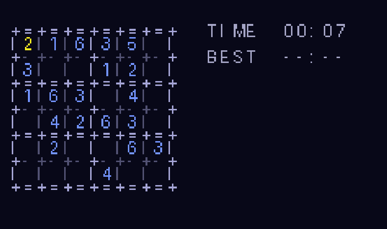

# GBA Sudoku

A simple 6x6 Sudoku game for the Game Boy Advance (digits 1-6, boxes are
2 rows x 3 columns), built with [devkitARM](https://devkitpro.org/) and
[libtonc](https://gbadev.net/tonc/), for running on real hardware via
an Everdrive GBA Pro (or any emulator).



## Controls

| Input          | Action                                             |
|-----------------|-----------------------------------------------------|
| D-pad           | Move the cursor around the grid                     |
| L / R           | Cycle the "loaded" digit (1-6)                      |
| A or B          | Place the loaded digit in the current cell (press again to clear it) |
| SELECT          | Hint - fills in one correct cell                    |
| START           | Start the next puzzle                               |

Numbers that duplicate another number in the same row, column, or box are
highlighted in red. The sidebar shows the elapsed time and your best time
for the current puzzle (best times reset when the game is powered off -
see Known limitations below). When the cursor sits on an empty cell, it
previews whichever digit is currently loaded, so you can see what A/B is
about to place.

## One-time setup (build toolchain)

On Ubuntu/Debian, install [devkitPro](https://devkitpro.org/)'s devkitARM
toolchain, libtonc, and the mGBA emulator:

```
wget -U "dkp-apt" https://apt.devkitpro.org/install-devkitpro-pacman
chmod +x install-devkitpro-pacman
sudo ./install-devkitpro-pacman
sudo dkp-pacman -Sy --noconfirm
sudo dkp-pacman -S --noconfirm gba-dev devkit-env
sudo apt install -y mgba-qt
```

Then set the environment variables devkitARM needs (add these to
`~/.bashrc` to make them permanent, or they may already be set for you by
the `devkit-env` package after your next login):

```
export DEVKITPRO=/opt/devkitpro
export DEVKITARM=$DEVKITPRO/devkitARM
export LIBTONC=$DEVKITPRO/libtonc
export PATH=$DEVKITARM/bin:$PATH
```

Open a **new terminal** (or `source ~/.bashrc`) so those take effect.

## Building

```
make
```

This produces `GBA_Sudoku.gba` in the project root.

## Testing in the emulator

```
mgba-qt GBA_Sudoku.gba
```

(or `make run`, which does the same thing)

## Running on real hardware (Everdrive GBA Pro)

1. Copy `GBA_Sudoku.gba` onto your Everdrive's SD card (any folder works;
   the Everdrive's menu will list it by filename).
2. Insert the SD card into the Everdrive GBA Pro cartridge, put the
   cartridge in your GBA Micro, and power on.
3. Select the game from the Everdrive menu.

## Puzzle data

The embedded puzzles live in `source/puzzles_data.h` and are generated by
`tools/gen_puzzles.py` - a real backtracking solver verifies each puzzle
has a **unique** solution before it's included. To regenerate (e.g. to
get a different/larger puzzle set), edit the parameters at the top of
that script and run:

```
cd tools && python3 gen_puzzles.py && mv puzzles_data.h ../source/
```

## Font

The sidebar/grid text uses a small 8x8 bitmap font auto-generated from
Pillow's built-in bitmap font by `tools/gen_font.py`, producing
`source/font_data.h`. Regenerate with:

```
cd tools && python3 gen_font.py && mv font_data.h ../source/
```

## Known limitations / possible follow-ups

- **No save file**: puzzle progress and best times reset whenever the
  game is powered off (by request, for this first version). Adding
  SRAM-backed save/resume support (which the Everdrive GBA Pro supports)
  would be a natural follow-up.
- Puzzles are a fixed embedded set (12 puzzles) rather than generated on
  the fly - simpler and more reliable on GBA hardware, at the cost of
  variety. More puzzles can be added by regenerating the puzzle data.

## License

MIT - see [LICENSE](LICENSE).
